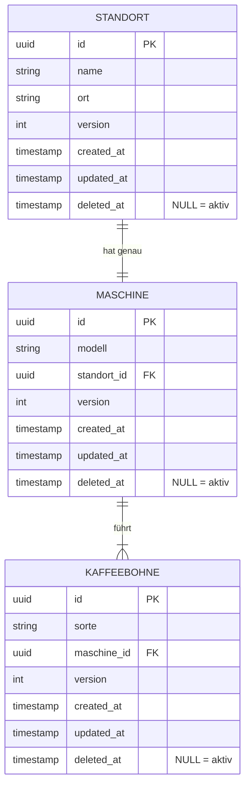

# coffee-machine-api

Lernprojekt für die Vorlesung **Serverentwicklung** (Semester 7, INFB): eine REST-API für
**Kaffeemaschinen** mit Hono, Drizzle und PostgreSQL.

## Datenmodell



- **Standort ↔ Maschine (1:1)** — jeder Standort hat genau eine Kaffeemaschine, erzwungen durch
  `UNIQUE (maschinen.standort_id)`
- **Maschine → Kaffeebohnen (1:N)** — eine Maschine führt mehrere Bohnensorten
- **ID** — alle Primärschlüssel als `uuid`, per `uuidv7()` von PostgreSQL erzeugt und damit
  zeitsortierbar
- **Audit** — `created_at` und `updated_at` in jeder Tabelle, `updated_at` per Trigger
- **Optimistic Locking** — der Trigger `coffee_touch` zählt `version` bei jedem `UPDATE` hoch.
  Wer mit einer veralteten `version` schreibt, trifft keine Zeile und bekommt `409 Conflict`
- **Soft Delete** — `deleted_at` ist in allen drei Tabellen vorhanden; `NULL` bedeutet aktiv

Das Schema liegt als SQL unter `db/init/01-schema.sql` und ist die Quelle der Wahrheit.
`src/db/schema.mts` und `src/db/relations.mts` werden daraus mit `drizzle-kit pull` **generiert**.

## Voraussetzungen

- Node **26.13.1** (steht in `.node-version`, z. B. `fnm use`)
- pnpm **12.23.0** (über `packageManager` gepinnt, `corepack enable` reicht)
- Docker bzw. Docker-kompatible CLI (hier: Podman mit `docker`-Emulation)

## Schnellstart

```bash
cp .env.example .env      # Zugangsdaten und Zertifikatspfade
pnpm install
make db-up                # PostgreSQL 18 und Keycloak 26.7.5 starten
pnpm start                # Server auf https://localhost:8443
```

Noch ohne Routen: der Server antwortet mit `404`, aber bereits über HTTP/2 und TLS.

| Komponente | URL / Zugang |
|---|---|
| API | <https://localhost:8443> (HTTP/2, selbstsigniertes Zertifikat) |
| Keycloak | <http://localhost:8080> — Admin `admin` / `admin` |
| PostgreSQL | `localhost:5432` — User `coffee`, Passwort `coffee`, DB `coffee_machine` |
| Drizzle Studio | `make db-studio` — <https://local.drizzle.studio> |

Realm `coffee` mit Client `coffee-api` (confidential), Rolle `admin` und User `demo` / `demo`
wird beim Container-Start aus `keycloak/realm-coffee.json` importiert.

`certs/` enthält ein selbstsigniertes Zertifikat für `localhost`. Bruno, Postman und curl
müssen ihm einmalig vertrauen (`curl -k`).

## Entwicklung

Das **Makefile** reicht jedes Ziel 1:1 an ein pnpm-Skript durch. Beide Wege sind gleichwertig,
`make` ist nur eine Abkürzung.

| Make-Ziel | pnpm-Skript | Zweck |
|---|---|---|
| `make start` | `pnpm start` | Server starten |
| `make dev` | `pnpm dev` | Server mit `--watch` starten |
| `make format` | `pnpm format` | `oxfmt` formatiert alle Dateien |
| `make lint` | `pnpm lint` | `oxlint` prüft alle Dateien |
| `make typecheck` | `pnpm typecheck` | `tsc --noEmit` prüft die Typen |
| `make check` | `pnpm check` | format, lint und typecheck nacheinander |
| `make db-up` | `pnpm db:up` | Container starten |
| `make db-down` | `pnpm db:down` | Container stoppen (Daten bleiben) |
| `make db-reset` | `pnpm db:reset` | Container stoppen und Volume verwerfen |
| `make db-schema` | `pnpm db:schema` | SQL-Schema nachträglich einspielen |
| `make db-pull` | `pnpm db:pull` | `schema.mts` und `relations.mts` neu erzeugen |
| `make db-studio` | `pnpm db:studio` | Drizzle Studio öffnen |

`make check` **ändert** Dateien: `oxfmt` schreibt das Format, `oxlint` meldet nur.

## Aufbau

```
src/
├─ config/env.ts      Umgebungsvariablen lesen und prüfen
├─ db/                generiert von drizzle-kit pull, nicht von Hand ändern
│  ├─ schema.mts
│  └─ relations.mts
├─ domain/            später: Zod-Schemas und Repositories
├─ http/app.ts        Hono-Instanz
└─ server.ts          HTTP/2-Server mit TLS
```

TypeScript läuft ohne Build: Node 26 entfernt die Typen beim Laden. Deshalb ist
`erasableSyntaxOnly` gesetzt — `enum`, `namespace` und Parameter-Properties sind nicht erlaubt,
weil sie sich nicht löschen lassen. `tsc` prüft nur die Typen und schreibt nichts.

## Checkliste

<details>
<summary>Anforderungen (aus der Checkliste)</summary>

### Vorbereitet

- Node 26.13.1, pnpm 12.23.0
- Relationale DB mit PostgreSQL 18 als Docker Container
  - 1:1 und 1:N-Beziehung
  - DB-Browser (Drizzle Studio)
- Keycloak als Docker Container: Realm `coffee`, Client `coffee-api`, User `demo`, Rolle `admin`
- Git-Repository mit generiertem Drizzle-Code (`schema.mts`, `relations.mts`)

### Infrastruktur

- `package.json` mit pnpm
- oxlint und oxfmt zzgl. Konfiguration

### Appserver

- TypeScript „State-of-the-Art“: `strict`, `noUncheckedIndexedAccess`,
  `exactOptionalPropertyTypes`, Named Exports
- REST durch Hono einschließlich HTTP/2 — Verdrahtung steht, Routen folgen

**Nicht umgesetzt (auf Vorgabe):** Vitest-Tests, `QUERY`/`DELETE`, Pagination
</details>